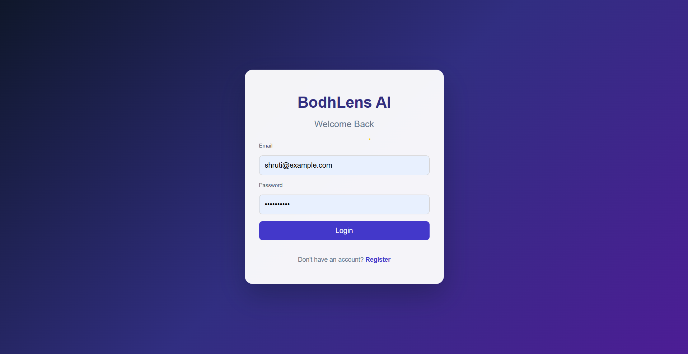
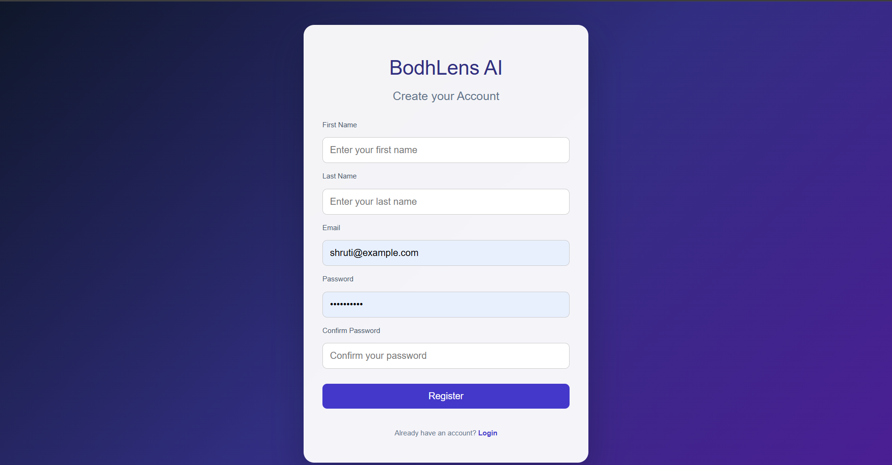
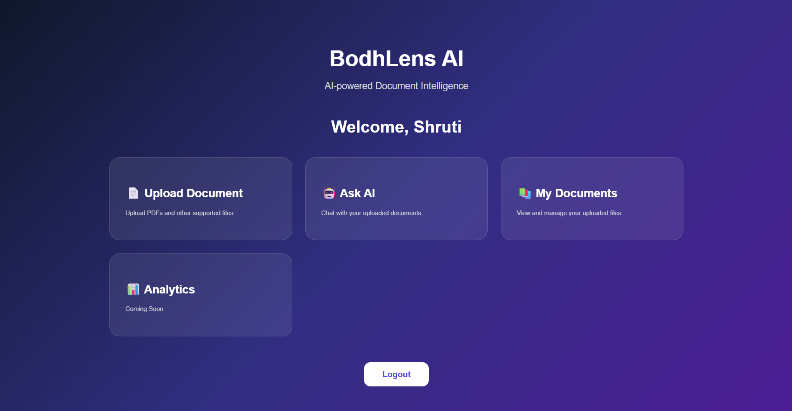
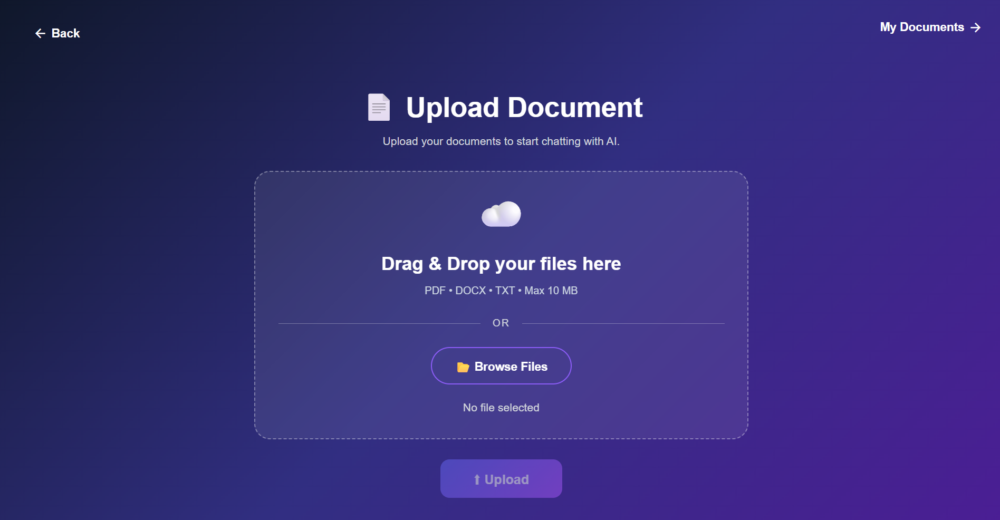
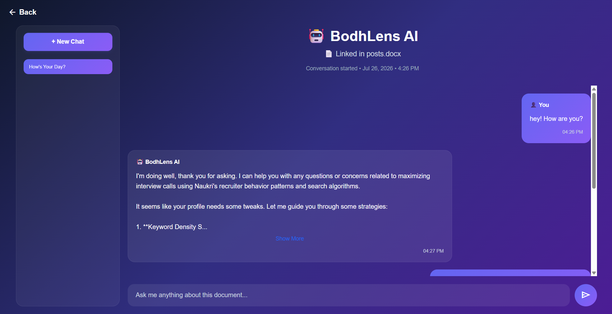

# BodhLens AI 📄🤖

BodhLens AI is an AI-powered document assistant that allows users to upload documents and interact with them using natural language. Users can upload PDFs, DOCX, and TXT files, ask questions, and get AI-generated answers based on the document content.

The application uses Retrieval-Augmented Generation (RAG) architecture with vector embeddings to provide context-aware responses from uploaded documents. It uses Ollama to run local Large Language Models (LLMs) and generate embeddings, enabling AI-powered document conversations without relying on external AI APIs.

---

## 🚀 Features
### Document Management
- Upload PDF, DOCX, and TXT documents
- Extract text from uploaded documents
- Automatically split documents into smaller chunks
- Generate vector embeddings for document chunks
- Store document data and embeddings in PostgreSQL using pgvector

### AI Chat Assistant
- Chat with uploaded documents
- Maintain separate chat sessions per document
- Store conversation history
- Generate AI responses using local LLMs
- Automatically generate chat titles

### Security
- User registration and login
- JWT-based authentication
- Secure API endpoints

---

## 🏗️ Architecture

BodhLens AI follows a client-server architecture with an Angular frontend, Spring Boot backend, PostgreSQL database, and AI services powered by Ollama.

```text
                         User
                          |
                          |
                 Angular Frontend
                   (BodhLens UI)
                          |
                          |
                    REST APIs
                          |
                          |
                Spring Boot Backend
                          |
        ---------------------------------
        |               |               |
        |               |               |
 Authentication   Document Processing   Chat Processing
     (JWT)              |                    |
                        |                    |
                Text Extraction        Chat Sessions
                        |
                Document Chunking
                        |
              Embedding Generation
                        |
                        |
              PostgreSQL + pgvector
          (Documents, Chunks, Embeddings)
                        |
                        |
                   Ollama AI
        (Embedding + Response Generation)
```

---

## 🔄 RAG Workflow

1. User uploads a document
2. Text is extracted from the document
3. Document is divided into smaller chunks
4. Each chunk is converted into vector embeddings
5. Embeddings are stored in PostgreSQL using pgvector
6. User asks a question
7. Relevant document context is retrieved
8. LLM generates an answer using the retrieved context

---

## 🛠️ Tech Stack

### Backend
- Java 21
- Spring Boot 3
- Spring Security
- JWT Authentication
- Spring Data JPA / Hibernate
- REST APIs

### Frontend
- Angular 22
- Angular Material
- Reactive Forms

### Database
- PostgreSQL
- pgvector extension

### AI
- Ollama
- Llama 3.2
- Vector Embeddings

### Tools
- Git
- Maven
- Postman

---

## 📸 Screenshots

### Login Page


### Registration Page


### Dashboard


### Document Upload


### AI Chat Interface


---

## 🚀 Future Enhancements

- Hybrid Search (Vector Search + Keyword Search)
- Advanced Document Processing Pipeline
- Support for Multiple Documents in a Single Chat
- Conversation Memory Enhancement
- Query Rewriting for Better Retrieval
- Reranking Retrieved Chunks
- Streaming AI Responses
- Citation and Source Highlighting
- Document Summarization Improvements
- Analytics Dashboard Enhancements
- AI Usage & Cost Monitoring
- Role-Based Document Access Control
- Cloud Deployment
- RAG Evaluation and Performance Monitoring